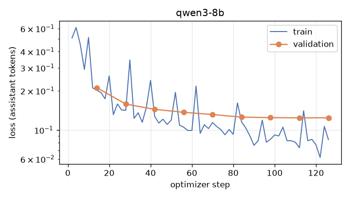

# extraction-distill

Distilling an OSINT entity / relation / event extractor from a 27B teacher into a
QLoRA-tuned **Qwen3-8B**, served with **vLLM**, on one 16 GB consumer GPU.

The extractor belongs to osint-agents, a separate OSINT investigation project: it reads a
news-style text in any of 9 languages and returns schema-constrained JSON with entities,
typed relations (with a stance: asserted / reported / denied / speculative), events and a
verbatim quote for every item. The production model, `qwen3.6:27b`, is accurate but takes
~31 s per document; the fast fallback, a 14B, loses a third of relation F1. The goal here:
a small student that keeps most of the teacher's relation quality at the 14B's speed or
better.

## Results

On osint-agents' 52-document hand-annotated gold set (9 languages; version `323524d796ec`),
scored by osint's own, unchanged eval. Full tables: [`results/RESULTS.md`](results/RESULTS.md).

| Model | Serving | Entities F1 | Relations F1 (P / R) | Events F1 | s / doc |
|---|---|---|---|---|---|
| `qwen3.6:27b` (teacher) | Ollama, Q4_K_M | 0.95 | 0.82 (0.73 / 0.94) | 0.85 | 31.3 |
| `qwen3-abliterated:14b` (current fast model) | Ollama, Q4_K_M | 0.88 | 0.55 (0.44 / 0.75) | 0.78 | 5.3 |
| Qwen3-8B, not fine-tuned | vLLM, FP8 | 0.92 | 0.54 (0.46 / 0.66) | 0.73 | 7.9 |
| **Qwen3-8B distilled** | vLLM, FP8 | 0.92 | **0.76 (0.64 / 0.94)** | 0.79 | **3.0** |
| **Qwen3-4B distilled** | vLLM, BF16 | 0.89 | **0.74 (0.66 / 0.84)** | 0.76 | **2.5** |

- **Relations**, the 14B's weak point: F1 0.55 → 0.76 for the 8B student (93% of the
  teacher's 0.82), with the teacher's recall (0.94) and precision up from 0.44 to 0.64.
  Against the same 8B before fine-tuning, on the same serving stack: 0.54 → 0.76.
- **Speed**: 3.0 s per document on one RTX 5070 Ti, 10× faster than the teacher and 1.8×
  faster than the 14B. The student writes the teacher's compact JSON (248 output tokens
  per document on average) where the untuned 8B writes 624, and 2 of its 52 answers are
  not valid JSON.
- **Events and entities** stay close to the 14B (0.79 vs 0.78, 0.92 vs 0.88); the student
  keeps all 10 off-topic documents out and every quote verifies.
- **The 4B student** is nearly as good (relations 0.74) and the fastest, at 2.5 s per
  document.

Serving throughput (vLLM, 52 gold-set requests per level, streaming, temperature 0):

| Model | Weights | Concurrency | Output tok/s | Latency p50 / p95 (s) | Docs / s |
|---|---|---|---|---|---|
| Qwen3-8B distilled | FP8 W8A8 | 1 | 83 | 2.96 / 5.44 | 0.33 |
| | | 4 | 312 | 3.13 / 5.62 | 1.26 |
| | | 16 | 1040 | 3.69 / 7.68 | 4.20 |
| Qwen3-4B distilled | BF16 | 1 | 87 | 2.50 / 5.12 | 0.39 |
| | | 4 | 324 | 2.63 / 5.35 | 1.49 |
| | | 16 | 1080 | 3.10 / 6.35 | 4.95 |
| Qwen3-8B, not fine-tuned | FP8 W8A8 | 1 | 82 | 5.01 / 14.08 | 0.13 |
| | | 16 | 564 | 7.84 / 101.49 | 0.78 |

At concurrency 16 the 8B student processes 4.2 documents per second, about 15,000 per hour,
on a 16 GB consumer GPU. Every answer from both students was valid JSON. GPU memory is
~14–15 GiB for every model because vLLM reserves 88% of the GPU for weights plus KV cache
(the 8B FP8 weights take 8.8 GiB).

Training (QLoRA, Unsloth): 665 training and 88 validation examples, 3 epochs, 126 steps,
32 min for the 8B (peak 9.7 GB VRAM) and 18 min for the 4B; final validation loss 0.124
for both.



### A bug worth knowing about: key order under guided decoding

The first trained student scored events F1 **0.26** (relations 0.73). The teacher, run
through Ollama, which does not enforce key order, always wrote an event as `type,
description, quote, time, ...`; the schema orders it `type, description, time, location,
participants, quote, ...`. vLLM's guided decoding (xgrammar) emits properties in schema
order, so once the student had written `quote`, `time` could no longer be emitted: every
event lost its date, and the scorer requires the date. Asked without guided decoding, the
same model dated 9 of 12 events; with it, 0 of 14. The fix is to store the training answers
in schema key order (`distill/schema_order.py`, same content; enforced by
`tests/test_schema_order.py`) and retrain: events F1 0.26 → 0.79. The first run is kept in
[`results/diagnostics/teacher-key-order/`](results/diagnostics/teacher-key-order/).

## Method

1. **Synthetic documents** (`distill/specs.py`, `distill/gen_docs.py`). Scenario specs are
   sampled in code: language (en, ar, ru, fr, es, he, fa, tr, de), scenario (claims and
   attacks, arrests, finance with crypto wallets, online infrastructure, meetings,
   leadership, affiliation, threats, denials, speculation, mixed stance, ~15% off-topic
   near-misses such as football "attacks" or hostile takeovers), length, register and
   invented names and identifiers. The local `qwen3-abliterated:14b` writes the text from
   the spec. Generated documents are filtered for script drift (the 14B sometimes slips
   CJK or Cyrillic letters into Arabic or Hebrew) and copied writer notes. No Claude output
   is used anywhere in the training data.
2. **Leakage guard** (`distill/leakage.py`, `tests/test_leakage.py`). No gold-set entity
   name or alias, and no 8-gram of any gold text, may appear in a training document or
   training example. The guard runs at generation time and again as a test over the final
   files.
3. **Teacher labels** (`distill/label.py`, `distill/schema_order.py`). osint-agents' own
   `LLMExtractor` (role `agent_heavy` = `qwen3.6:27b`) labels every document, so the system prompt, user prompt
   and JSON schema are byte-for-byte the production ones. A recording LLM client saves the
   exact chat messages and the teacher's JSON. A document is kept only if the first answer
   validated against the schema and every quote verifies against the text with osint's
   `QuoteIndex`. The answers are then stored in the schema's key order (see Results).
4. **QLoRA SFT** (`train/train_sft.py`). Unsloth, Qwen3-8B in 4-bit NF4, LoRA on all linear
   layers. The loss covers the assistant JSON only; the prompt is rendered exactly as vLLM
   renders it at serving time (Qwen3 chat template, thinking off), and the trainer asserts
   that. 10% of documents (hash split) are held out for validation loss.
5. **Merge and quantize** (`serve/merge_lora.py`, `serve/quantize.py`). The adapter is
   merged into the BF16 weights shard by shard (peak RAM ≈ one shard), then quantized with
   llm-compressor: FP8 W8A8 (dynamic activations, no calibration) and AWQ W4A16
   (calibrated on 256 training examples). Qwen3-8B in BF16 (16.4 GB) does not fit the GPU,
   so every served 8B model is quantized, including the untuned baseline.
6. **Serve** (`serve/serve.sh`). vLLM's OpenAI-compatible server; osint sends the JSON
   schema as `response_format`, so decoding is schema-guided (xgrammar).
7. **Evaluate** with osint-agents' unchanged scorer (`osint eval extraction`, given new
   `--backend/--base-url` options) on its 52-document hand-annotated gold set
   (`distill/run_eval.py`).
8. **Benchmark** (`bench/bench_serving.py`). The 52 gold-set extraction requests, replayed
   at concurrency 1, 4 and 16 with streaming, temperature 0 and the production 6000-token
   cap.

## Reproduce

Hardware: RTX 5070 Ti 16 GB, 32 GB RAM, Windows 11 + WSL Ubuntu. Ollama runs on Windows,
so the steps that use it run there in osint-agents' environment; training and serving run
in WSL.

```bash
# WSL: venvs (training: Unsloth; serving: vLLM; quantization: llm-compressor)
bash scripts/setup_wsl.sh && bash scripts/setup_ml.sh

# Windows, from this repo (Ollama with qwen3-abliterated:14b and qwen3.6:27b)
uv run --project C:\code\osint-agents python -m distill.gen_docs --n 1400
uv run --project C:\code\osint-agents python -m distill.gen_docs --n 600 --seed 8 --start 10000 --langs ar fa he
uv run --project C:\code\osint-agents python -m distill.label          # ~50 s/doc; stopped at 790 docs here
uv run --project C:\code\osint-agents python -m distill.export_prompts # benchmark workload + schema
uv run --project C:\code\osint-agents python -m distill.schema_order   # answers in schema key order
uv run --project C:\code\osint-agents python -m pytest                 # leakage guard, key order

# WSL: train, merge, quantize, serve (unload Ollama's models first: one GPU job at a time)
python train/train_sft.py --run qwen3-8b
python serve/merge_lora.py --adapter ~/distill-data/runs/qwen3-8b/adapter --out ~/distill-data/models/qwen3-8b-distill
python serve/quantize.py --model ~/distill-data/models/qwen3-8b-distill --scheme fp8
serve/serve.sh ~/distill-data/models/qwen3-8b-distill-fp8 qwen3-8b-distill-fp8
python bench/bench_serving.py --model qwen3-8b-distill-fp8 --label "Qwen3-8B distilled" --weights "FP8 W8A8"

# Windows: score with osint's eval, then rebuild the tables
uv run --project C:\code\osint-agents python -m distill.run_eval --model qwen3-8b-distill-fp8
python results/build_report.py
```

Or all of steps 4–8 unattended, from Windows: `python scripts/after_labeling.py --no-wait
--skip quant_awq` (trains, merges and quantizes in WSL, then serves, evaluates and
benchmarks each model in turn).

## Limitations

- **Small gold set.** 52 documents, 32 gold relations and 41 gold events: one relation is
  ~3 points of recall, and per-language scores rest on 2–6 relations each. The gaps
  between the 8B and 4B students (0.76 vs 0.74) are within that noise.
- **Small, synthetic training set.** 753 examples (665 train, 88 validation). Labeling was
  stopped early at 790 of the 1,280 generated documents: the 27B teacher runs partly from
  system RAM (~50 s per document), and the machine ran out of memory. Hebrew has only 21
  examples. The documents are fictional texts written by the local 14B, not real news, so
  their style is narrower than the real inputs.
- **Teacher bias.** The student learns the teacher's labels, mistakes included; it cannot
  get above the teacher, and the teacher's own error modes (e.g. 3 false relations from
  denials or speculation) carry over: the 8B student makes 4.
- **Speed comparison across serving stacks.** The teacher and the 14B run on Ollama (GGUF
  Q4_K_M, the 27B partly on CPU); the students run on vLLM with FP8 or BF16. The s/doc
  comparison with them mixes model size and serving stack. The untuned and distilled 8B
  (same stack, same weights format) isolate the effect of fine-tuning.
- **AWQ not reported.** The AWQ W4A16 calibration ran out of GPU memory (16 GB) and was
  skipped; FP8 fits and is what the 8B serves with.
- **One run each**, no seeds averaged.

**In one line:** distilled a 27B multilingual entity/relation/event extractor into a
QLoRA-tuned Qwen3-8B on synthetic data (leakage-guarded); relation F1 0.55 → 0.76 versus
the production fast model at 1.8× its speed (3.0 s/doc, 1,040 tok/s at concurrency 16 on
vLLM FP8, one 16 GB GPU).
