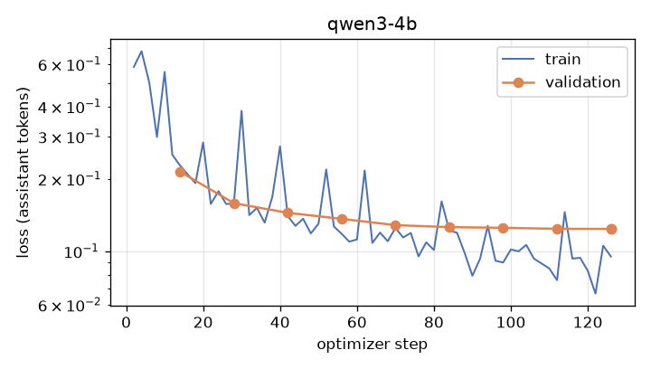

# Results

Gold set: osint-agents `evals/extraction/gold.jsonl`, 52 documents, version `323524d796ec`. Generated by `results/build_report.py`.

## Extraction quality

| Model | Serving | Entities F1 (P / R) | Relations F1 (P / R) | Events F1 (P / R) | Quotes verified | False relations from denials / speculation | Off-topic rejected | s / doc |
|---|---|---|---|---|---|---|---|---|
| `qwen3.6:27b` (teacher) | Ollama, Q4_K_M | 0.95 (0.92 / 0.98) | 0.82 (0.73 / 0.94) | 0.85 (0.85 / 0.85) | 100% | 3 | 10 / 10 | 31.3 |
| `qwen3-abliterated:14b` (current fast model) | Ollama, Q4_K_M | 0.88 (0.83 / 0.93) | 0.55 (0.44 / 0.75) | 0.78 (0.80 / 0.76) | 99% | 2 | 9 / 10 | 5.3 |
| Qwen3-8B, not fine-tuned | vLLM, FP8 | 0.92 (0.92 / 0.92) | 0.54 (0.46 / 0.66) | 0.73 (0.76 / 0.71) | 100% | 3 | 10 / 10 | 7.9 |
| **Qwen3-8B distilled** | vLLM, FP8 | 0.92 (0.90 / 0.94) | 0.76 (0.64 / 0.94) | 0.79 (0.77 / 0.81) | 100% | 4 | 10 / 10 | 3.0 |
| **Qwen3-4B distilled** | vLLM, BF16 | 0.89 (0.90 / 0.88) | 0.74 (0.66 / 0.84) | 0.76 (0.85 / 0.68) | 96% | 1 | 10 / 10 | 2.5 |

## Relation F1 by language

| Model | en | ar | de | es | fa | fr | he | ru | tr |
|---|---|---|---|---|---|---|---|---|---|
| `qwen3.6:27b` (teacher) (Ollama, Q4_K_M) | 0.77 | 0.86 | 1.00 | 0.67 | 1.00 | 1.00 | 1.00 | 0.89 | 1.00 |
| `qwen3-abliterated:14b` (current fast model) (Ollama, Q4_K_M) | 0.60 | 0.44 | 0.67 | 0.67 | 0.00 | 0.33 | 0.80 | 0.50 | 0.00 |
| Qwen3-8B, not fine-tuned (vLLM, FP8) | 0.51 | 0.50 | 1.00 | 1.00 | 1.00 | 0.67 | 0.50 | 0.75 | 0.00 |
| **Qwen3-8B distilled** (vLLM, FP8) | 0.72 | 0.86 | 1.00 | 1.00 | 1.00 | 0.40 | 0.67 | 1.00 | 1.00 |
| **Qwen3-4B distilled** (vLLM, BF16) | 0.71 | 0.86 | 1.00 | 1.00 | 0.00 | 0.50 | 0.80 | 0.75 | 1.00 |

## Serving (vLLM, RTX 5070 Ti 16 GB)

| Model | Weights | Concurrency | Output tok/s (total) | Decode tok/s per request | Latency p50 / p95 (s) | TTFT p50 (s) | Docs / s | Peak GPU memory (GiB) |
|---|---|---|---|---|---|---|---|---|
| Qwen3-4B distilled | BF16 | 1 | 87 | 90 | 2.50 / 5.12 | 0.03 | 0.39 | 14.9 |
| Qwen3-4B distilled | BF16 | 4 | 324 | 86 | 2.63 / 5.35 | 0.04 | 1.49 | 14.9 |
| Qwen3-4B distilled | BF16 | 16 | 1080 | 73 | 3.10 / 6.35 | 0.06 | 4.95 | 14.9 |
| Qwen3-8B, not fine-tuned | FP8 W8A8 | 1 | 82 | 85 | 5.01 / 14.08 | 0.03 | 0.13 | 14.0 |
| Qwen3-8B, not fine-tuned | FP8 W8A8 | 4 | 259 | 77 | 5.55 / 15.02 | 0.05 | 0.42 | 14.1 |
| Qwen3-8B, not fine-tuned | FP8 W8A8 | 16 | 564 | 50 | 7.84 / 101.49 | 0.08 | 0.78 | 14.2 |
| Qwen3-8B distilled | FP8 W8A8 | 1 | 83 | 85 | 2.96 / 5.44 | 0.03 | 0.33 | 14.8 |
| Qwen3-8B distilled | FP8 W8A8 | 4 | 312 | 82 | 3.13 / 5.62 | 0.04 | 1.26 | 14.8 |
| Qwen3-8B distilled | FP8 W8A8 | 16 | 1040 | 71 | 3.69 / 7.68 | 0.06 | 4.20 | 14.8 |

## Training

**qwen3-4b**: base `unsloth/Qwen3-4B-unsloth-bnb-4bit`, 4-bit NF4 base (QLoRA), LoRA r=32 alpha=32 on all linear (q,k,v,o,gate,up,down), lr 0.0002 (cosine, 5% warmup), 3 epochs, effective batch 16, adamw_8bit, bf16. 665 training / 88 validation documents (0 dropped as longer than 6144 tokens). 126 steps in 18.4 min, peak VRAM 5.94 GB, final validation loss 0.1238.

**qwen3-8b**: base `unsloth/Qwen3-8B-unsloth-bnb-4bit`, 4-bit NF4 base (QLoRA), LoRA r=32 alpha=32 on all linear (q,k,v,o,gate,up,down), lr 0.0002 (cosine, 5% warmup), 3 epochs, effective batch 16, adamw_8bit, bf16. 665 training / 88 validation documents (0 dropped as longer than 6144 tokens). 126 steps in 31.7 min, peak VRAM 9.65 GB, final validation loss 0.1242.

